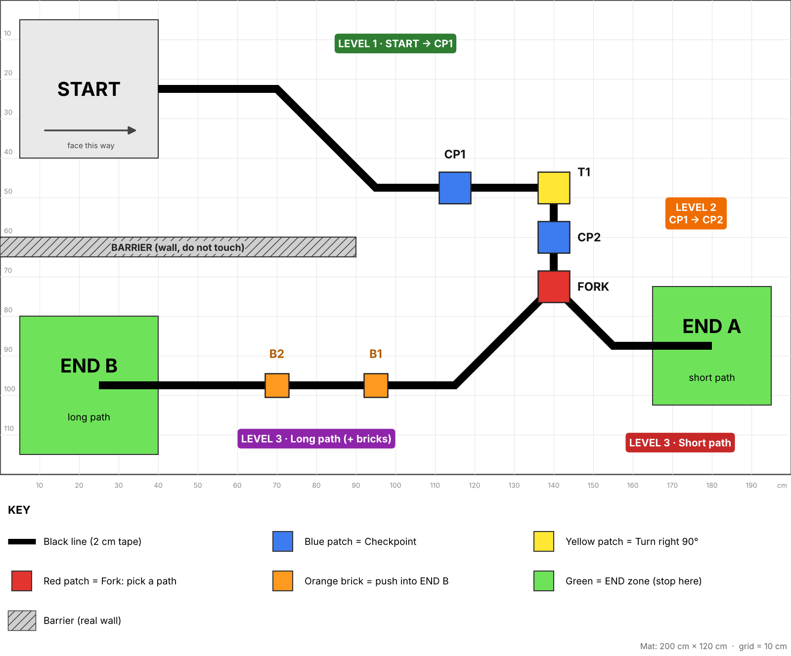
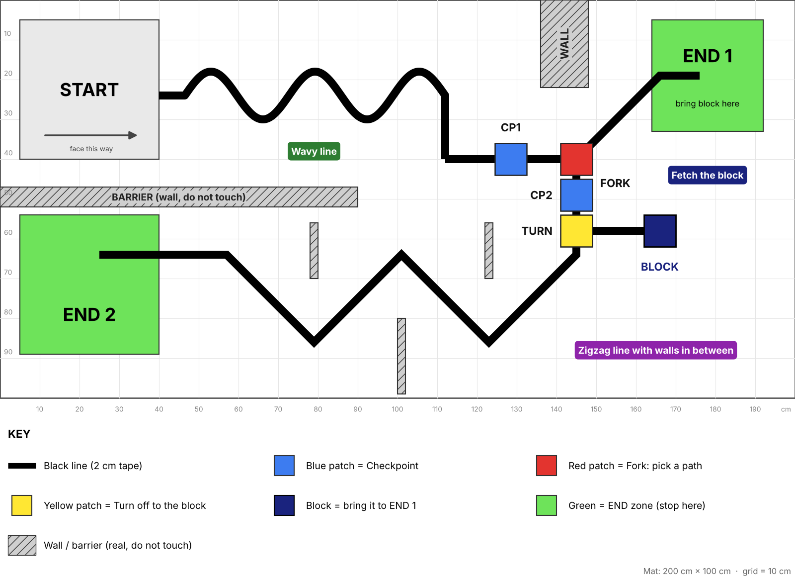

# EV3 Line Tracing Challenge (P6 Edition)
A simpler competition for Primary 6 students who have just learned EV3.  
Everyone can score points, and stronger teams can keep going to the next level.

This is the codebase that contains all the files that we will use in the Workshop.  
## Step 1: Download EV3 Classroom App
Download the App through this link:  
https://education.lego.com/en-us/downloads/mindstorms-ev3/software/  
Download the files and open the launcher.
## Step 2: Download All the files in the Lesson files
Download all the files in [Lesson files](./Lesson%20Files/)  
OR  
Download the entire repositry as a zip file and unzip it.
## Step 3: Lesson 1 and 2
Open the Files downloaded  
Follow the Lesson pace and slides.
## Step 4: Lesson 3 - 7  
These Lessons are to be done at your own pace.
After each lesson, notify one of us and we will ensure that you have done the exercise correctly

# Competition Rules
After finishing all the lessons, you can start preparing for the competition.  
You may change your robot's build and improve your code before the competition.

## Choose Your Map
There are **two maps**. Each team picks **one** map before its first run and uses it for all 3 runs.  
Easy and Hard teams are **ranked separately**.

| Map | Picture | What it's like | Best for |
|-----|---------|----------------|----------|
| **Easy Map** | [Map.png](./Map.png) | Straight lines, gentle bends, one 90° turn and one fork | Teams who are new to EV3 |
| **Hard Map** | [Map-Hard.png](./Map-Hard.png) | Wavy curves, a zigzag with walls in between, and a block to fetch and deliver | Teams who want a real challenge |

The Hard Map is designed so it **can't be hard-coded**. Your robot has to really follow the line and use its sensors.

---

# Easy Map
**Your mission:** Follow the black line from **START**, pass the checkpoints, then choose a path at the **FORK** and stop in an **END** zone.  
The further your robot goes, the more points you get!

### The Three Levels
The line is made only of **straight pieces**. They meet at different angles: gentle **45° bends** and one sharp **90° turn**.

| Level | Route | What your robot must do | Lessons that help |
|-------|-------|-------------------------|-------------------|
| **Level 1** | START → CP1 | Follow the line through two 45° bends | Line Tracing (Lesson 7) |
| **Level 2** | CP1 → CP2 | Turn **right 90°** at the yellow patch **T1** | 90° Turns (Lesson 4), Turning (Lesson 6) |
| **Level 3** | CP2 → FORK → END | At the red **FORK**, pick a path and stop inside its green END zone | All lessons |

#### Level 3: Pick Your Path
| Path | Direction at the FORK | What's on it | Points |
|------|------------------------|--------------|--------|
| **Short path → END A** | Robot goes **left** | Two 45° bends, nothing else | Fewer points, easier |
| **Long path → END B** | Robot goes **right** | Longer line with two bricks to push | More points, harder |

You only get points for **one** END zone per run.

### What the Colours Mean
| Colour | What it is | What it means for your robot |
|--------|-----------|------------------------------|
| Black line | Tape on the mat | Follow it |
| Blue patch (CP1, CP2) | Checkpoint on the line | You have finished a level. Bonus if your robot beeps here! |
| Yellow patch (T1) | Turn marker on the line | Sharp turn: turn **right 90°** here |
| Red patch | The FORK | Choose your path: left to END A or right to END B |
| Orange brick (B1, B2) | Real brick on the long path | Push it into END B for bonus points |
| Green zone | END zone | Stop your robot here |
| Grey barrier | Real wall | Do not touch it |

**Every colour has one fixed meaning.** You don't have to guess.

### Easy Map Scoring
#### Level Points
| Reached | Points |
|---------|--------|
| Level 1: robot reaches **CP1** | 10 |
| Level 2: robot reaches **CP2** | +20 |
| Level 3: robot **stops** in **END A** (short path) | +20 |
| Level 3: robot **stops** in **END B** (long path) | +30 |

#### Bonus Points
| Bonus | Points |
|-------|--------|
| Each orange brick **fully inside** END B | +10 each (max 20) |
| Robot **beeps or shows a sign** when it reaches each checkpoint | +5 each (max 10) |
| Robot stops in an END zone in **under 1 minute** | +10 |

**Maximum score: 70 points on the short path, 100 points on the long path.**

A checkpoint counts as reached when the front of the robot passes over the blue patch while following the line.

### Easy Map Run Rules
1. **Starting:** The robot must be fully inside the START zone, facing the line (see the arrow on the map).
2. **Hands off:** After you press start, don't touch the robot. If you touch it, the run ends.
3. **Follow the line:** Your robot must follow the black line. It may leave the line only to make the sharp turn at the yellow patch.
4. **No shortcuts:** If your robot cuts across the mat to skip part of the line, the run ends.
5. **Barrier:** If your robot touches the barrier, the run ends.
6. **Time limit:** Each run lasts up to **2 minutes**.
7. **END zone:** At least **half of the robot** must be inside the green zone and the robot must **stop**. The run ends when it stops there.
8. **Keep your points:** If a run ends early (touching, shortcut, barrier, or time up), **you keep the points you already earned** in that run.
9. **Tries:** Each team gets **3 runs**. You may pick a different path on each run. Your **best run** counts.
10. **Reset:** The bricks are put back in the same places before every run.
11. **Tie-breaker:** If two teams have the same score, the faster best run wins.

### Easy Map Setup
Mat size: **200 cm × 120 cm** on a white or light surface. The map has a 10 cm grid to help with placing items.  
Positions below are measured in cm from the **top-left corner** (x = across, y = down). Every line piece is a straight strip of 2 cm black tape running between the points listed.

| Item | Size | Position |
|------|------|----------|
| START zone | 35 × 35 cm, grey/white outline | x 5 to 40, y 5 to 40 |
| END A (short path) | 30 × 30 cm, green | x 165 to 195, y 72.5 to 102.5 |
| END B (long path) | 35 × 35 cm, green | x 5 to 40, y 80 to 115 |
| Main line | 2 cm tape | (40, 22.5) → (70, 22.5) → (95, 47.5) → T1 (140, 47.5) → FORK (140, 72.5) |
| Short path line | 2 cm tape | FORK (140, 72.5) → (155, 87.5) → (180, 87.5), ending inside END A |
| Long path line | 2 cm tape | FORK (140, 72.5) → (115, 97.5) → (25, 97.5), ending inside END B |
| CP1 (blue) | 8 × 8 cm, on the line | (115, 47.5) |
| T1 (yellow) | 8 × 8 cm, on the corner | (140, 47.5) |
| CP2 (blue) | 8 × 8 cm, on the line | (140, 60) |
| FORK (red) | 8 × 8 cm, where the line splits | (140, 72.5) |
| Brick B1 (orange) | about 6 × 6 cm | (95, 97.5), on the line |
| Brick B2 (orange) | about 6 × 6 cm | (70, 97.5), on the line |
| Barrier | 90 cm long, about 5 cm thick, at least 5 cm tall | x 0 to 90, y 60 to 65 |

The barrier sits between START and END B so robots can't drive straight down to the finish.

### Easy Map Hints
- **Level 1:** 45° bends are gentle, so good line tracing can follow them. Slow down at the bends if your robot loses the line.
- **Level 2:** Use your colour sensor to spot **yellow**. When you see it, drive forward a little, then turn right 90°.
- **The FORK:** Your robot follows one **edge** of the line. Which edge you follow decides which way the robot goes when the line splits. You can also use the **red** patch as a signal to switch edges or to make a small turn.
- **Level 3:** Spot **green** to know when to stop. On the long path, push the bricks gently. If you go too fast, they may slide off the line.
- **Bonus:** Make your robot play a sound when the colour sensor sees **blue**.

---

# Hard Map
**Your mission:** Follow the wavy line from **START** to **CP1**, then choose at the red **FORK**:
- **Block mission:** go down past **CP2**, turn off at the yellow **TURN** patch, collect the **block**, bring it back up the line and deliver it into **END 1**.
- **Zigzag route:** go down past **CP2** and **TURN**, follow the zigzag between the walls and stop in **END 2**.

### Hard Map Sections
| Section | Route | What your robot must do |
|---------|-------|-------------------------|
| **Section 1** | START → CP1 | Follow the rounded waves (three tops), then a 90° drop and a straight |
| **Section 2** | CP1 → FORK → CP2 | Pass the FORK going **down** and reach CP2 |
| **Section 3a: Block mission** | CP2 → TURN → block → back to FORK → END 1 | Turn off at yellow, collect the block, return along the line, go **up** at the FORK and deliver the block into END 1 |
| **Section 3b: Zigzag route** | CP2 → zigzag → END 2 | Follow the zigzag without touching the walls between its points and stop in END 2 |

### What the Colours Mean (Hard Map)
| Colour | What it is | What it means for your robot |
|--------|-----------|------------------------------|
| Black line | Tape on the mat | Follow it |
| Blue patch (CP1, CP2) | Checkpoint on the line | You have finished a section. Bonus if your robot beeps here! |
| Red patch | The FORK | Up to END 1, or down to CP2 |
| Yellow patch (TURN) | Turn-off marker | Turn here to go to the block |
| Dark blue block | Real object | Collect it and bring it to END 1 |
| Green zone | END 1 or END 2 | Stop your robot here |
| Grey walls | Real walls | Do not touch them |

### Hard Map Scoring
#### Section Points
| Reached | Points |
|---------|--------|
| Section 1: robot reaches **CP1** | 15 |
| Section 2: robot reaches **CP2** | +15 |
| Block mission: robot **collects the block** (moves it off its spot and brings it back to the line) | +10 |
| Block mission: block **fully inside END 1** and robot **stopped** in END 1 | +40 |
| Zigzag route: robot **stops** in **END 2** | +30 |
| Robot stops in END 1 **without** the block | +10 |

#### Bonus Points
| Bonus | Points |
|-------|--------|
| Robot **beeps or shows a sign** when it reaches each checkpoint | +5 each (max 10) |
| Robot stops in an END zone in **under 2 minutes** | +10 |

**Maximum score: 100 points on the block mission, 80 points on the zigzag route.**  
Only **one** END zone counts per run.

### Hard Map Run Rules
All the Easy Map run rules apply, with these changes:
1. **Time limit:** Each run lasts up to **3 minutes**.
2. **Walls:** If your robot touches **any** wall (the tall wall, the zigzag walls or the barrier), the run ends. You keep the points you already earned.
3. **Leaving the line:** Your robot may leave the line only at the yellow **TURN** patch, to reach the block and come back.
4. **Carrying the block:** You may build a gripper or scoop from your EV3 kit. The block can be pushed or carried.
5. **Reset:** The block is put back in the same place before every run.

### Hard Map Setup
Mat size: **200 cm × 100 cm** (2 m × 1 m), positions in cm from the **top-left corner**.

| Item | Size | Position |
|------|------|----------|
| START zone | 35 × 35 cm | x 5 to 40, y 5 to 40 |
| END 1 | 28 × 28 cm, green | x 164 to 192, y 5 to 33 |
| END 2 | 35 × 35 cm, green | x 5 to 40, y 54 to 89 |
| Wavy line | 2 cm tape | (40, 24) → (46.5, 24), then 2½ rounded waves to (112, 24) (tops at y 18 near x 53, 79 and 105.5; bottoms at y 30 near x 66 and 92), then straight down to (112, 40) |
| Straight to FORK | 2 cm tape | (112, 40) → FORK (145, 40) |
| Branch to END 1 | 2 cm tape | FORK (145, 40) → (166, 19) → (176, 19), ending inside END 1 |
| Line down to zigzag | 2 cm tape | FORK (145, 40) → (145, 64) |
| Zigzag to END 2 | 2 cm tape | (145, 64) → (123, 86) → (101, 64) → (79, 86) → (57, 64) → (25, 64), ending inside END 2 |
| Side line to block | 2 cm tape | TURN (145, 58) → (162, 58) |
| CP1 (blue) | 8 × 8 cm | (128.5, 40) |
| FORK (red) | 8 × 8 cm | (145, 40) |
| CP2 (blue) | 8 × 8 cm | (145, 49) |
| TURN (yellow) | 8 × 8 cm | (145, 58) |
| Block (dark blue) | about 8 × 8 × 8 cm | x 162 to 170, y 54 to 62 |
| Tall wall | 12 cm thick, at least 5 cm tall | x 136 to 148, y 0 to 22 |
| Zigzag walls | 2 cm thick, at least 5 cm tall | x 123, y 56 to 70 · x 101, y 80 to 99 · x 79, y 56 to 70 |
| Barrier | 90 cm long, 5 cm thick | x 0 to 90, y 47 to 52 |

**Facilitators:** this layout was checked in a computer simulation with a standard EV3 driving base (about 15 cm wide and 19 cm long). All three routes could be completed, and the robot never hangs over the edge of the 2 m × 1 m mat. Keep the walls at the positions above: moving them closer to the line makes the map impossible. Still do a test run with a real robot before the event.

### Hard Map Hints
- **Waves:** slow down and use a smooth (proportional) line follower. A simple left-right follower will lose the line on tight curves.
- **FORK:** decide which way to go when you see **red**. Count how many times you've passed it if your robot comes back.
- **Block mission:** spot **yellow** to turn off. After collecting the block, drive back to the line and follow it up to the FORK.
- **Zigzag:** the walls are there so you can't cut corners. Slow down before each point of the zigzag and follow the line closely.
- **END zones:** spot **green** to know when to stop.

---

# For Both Maps
## Robot Rules
- Use only parts from your EV3 kit.
- Your robot must fit inside the START zone (35 cm × 35 cm) at the start.
- You may change your code between runs, but the next run must start within 2 minutes.

**Make sure everyone understands the rules before the competition starts. Good luck and have fun!**
